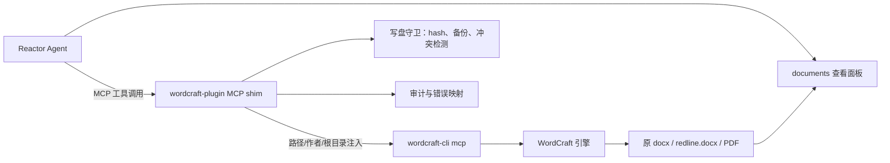
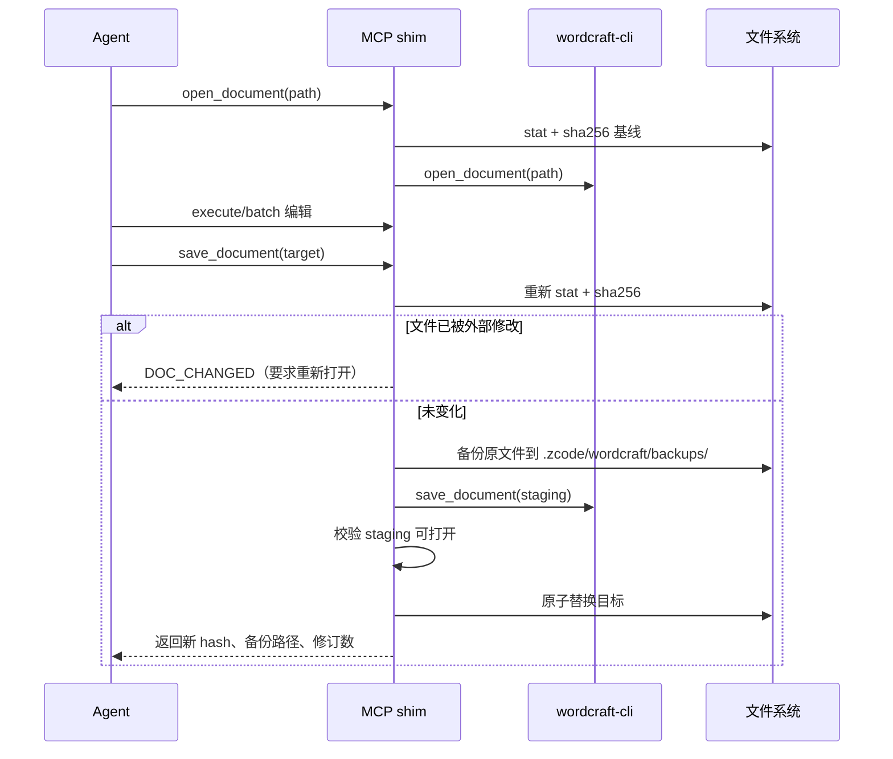

# WordCraft 无界面 Word 编辑接入规格（移植文档）

> 日期：2026-11-23
> 状态：草案，待评审；未开始实现
> 范围：把 WordCraft 作为「编辑已有 `.docx`」的 MCP 工具接入 Reactor
> 关联：
> - [内置文档插件查看面板规格](./2026-10-15-office-viewer-builtin-panels-spec.md)
> - [documents 插件说明](../../apps/zcode-cli/packages/documents-plugin/README.md)
> - [ADR-0005 桌面 Office 编辑器](../../docs/adr/0005-desktop-office-editor-embedding.md)（GenOffice 路线已放弃，待标记 superseded）

## 1. 背景与结论

Reactor 当前的四件套（`documents` / `spreadsheets` / `presentations` / `pdf`）已经覆盖：

- **查看**：四个只读 MCP 面板，支持打开、读取、搜索、定位、截图。
- **生成**：四件套生产技能，使用 Python + LibreOffice 生成或转换新文件。

缺少的是：

- **编辑已有 Word 文档**：打开用户或第三方给的 `.docx`，在原排版上修改，并让人能审阅 AI 改了什么。

GenOffice 路线已放弃，当前没有选定的 Word 编辑内核。WordCraft 提供纯 Rust 引擎、命令级编辑、修订跟踪和 headless MCP，正好补这一层。

**决策：先做「AI 无界面改 Word」**，以独立官方插件接入 `wordcraft-cli mcp`。四件套的查看面板和生产技能保持不变；本方案不引入编辑器 UI，不替换四件套。

### 1.1 为什么不做编辑器

- WordCraft 的 egui 编辑器与 Reactor 现有 MCP 面板、`webContentsView`、手机 Web 是不同技术栈，输入法、主题、快捷键、文件租约都要另建一套。
- 当前选定范围只需要 Agent 改文件，不需要人在 Reactor 内直接编辑。
- 编辑器接入必须重新裁决唯一写入者与前端承载方式，不能顺带做。

### 1.2 为什么不做第二套 Office 四件套

- Excel / PPT 不在 WordCraft 能力范围内。
- 四件套查看与生成已经存在，重复实现只会增加工具选择和状态同步成本。
- 本插件只暴露 **Word 编辑** 相关工具，查看仍走 `documents` 面板。

## 2. 能力边界

### 2.1 本方案增强的能力

| 能力 | 现状 | 接入后 |
| --- | --- | --- |
| 改已有 `.docx` | 只能重新生成或用一次性 Python 脚本，格式易丢 | 打开原文件，命令级修改，按原格式保存 |
| AI 改动可审阅 | 无修订、无批注 | 以独立作者写 track changes / comments，产出 redline |
| 改完自检 | 只能读文本或截图 | `inspect_document` 读结构，`render_page` 出真实分页图 |
| 严格 PDF | LibreOffice 转换，缺字/缺图可能静默成功 | `file.exportPdf {strict:true}` 拒绝出件并返回 JSON 报告 |
| 批量 Word 处理 | 每个文件让模型写脚本 | `batch` / `execute` 命令级处理 |
| 邮件合并 | 无统一入口 | WordCraft 原生邮件合并命令 |

### 2.2 本方案不覆盖

- `.xlsx` / `.pptx` 编辑。
- `.pdf` 内容编辑；只能导出与严格校验。
- 文件查看；继续使用四件套面板。
- 实时协作；`--connect` 上游当前拒绝，只能“改盘后重载”。
- 新建文档的默认路径；生成仍优先使用 `documents` 的生产技能。

## 3. 总体架构



组件职责：

- **wordcraft-plugin**：官方插件，提供 MCP server 与 `wordcraft-edit` 技能。
- **MCP shim**（`dist/server.mjs`）：定位平台二进制、注入根目录与作者、过滤工具、拦截保存类命令、执行写盘守卫。
- **wordcraft-cli**：平台原生二进制，以 stdio MCP 运行，不联网。
- **documents 面板**：只读查看编辑后的文件，不参与写入。

## 4. 插件清单

插件名、包名与版本：

```text
marketplace: zcode-plugins-official
name:        wordcraft
package:     @zcode/wordcraft-plugin
version:     0.1.0
license:     Apache-2.0（本仓库包装代码）
upstream:    MIT OR Apache-2.0（WordCraft 本体）
```

`.zcode-plugin/plugin.json` 草案：

```json
{
  "name": "wordcraft",
  "version": "0.1.0",
  "description": "Headless Word editing for DOCX with tracked changes and strict PDF export.",
  "description_i18n": {
    "en": "Edit existing Word documents with tracked changes, comments and strict PDF export.",
    "zh-CN": "编辑已有 Word 文档，支持修订跟踪、批注与严格 PDF 导出。"
  },
  "author": { "name": "Z.ai" },
  "license": "Apache-2.0",
  "skills": "skills",
  "mcpServers": {
    "wordcraft": {
      "type": "stdio",
      "command": "node",
      "args": ["${ZCODE_PLUGIN_ROOT}/dist/server.mjs"],
      "cwd": "${ZCODE_PROJECT_DIR}",
      "env": {
        "ZCODE_WORKSPACE_ROOT": "${ZCODE_PROJECT_DIR}"
      },
      "isolation": "workspace"
    }
  }
}
```

说明：

- 不声明 `ui.surfaces`，因此不产生额外面板。
- `isolation: "workspace"` 与四件套 MCP server 保持一致。
- 插件默认不启用（官方 definition 的 `defaultEnabled` 不设为 true），由试点用户显式开启。
- 许可证随包附带 `LICENSE-APACHE`、`NOTICE`、`ATTRIBUTION.md` 与各 OFL 字体许可证。

## 5. 二进制资产与平台矩阵

### 5.1 实测资产

v0.18.1 各平台包均自带 CLI；macOS 另有独立 CLI 包。

| 平台 | 来源 | CLI 路径 | 解包后大小 | 压缩包 SHA-256 |
| --- | --- | --- | ---: | --- |
| Linux x86_64 | `wordcraft-0.18.1-linux-x86_64.tar.gz` | `bin/wordcraft-cli` | 92,190,888 B | `312a057d46dd80597c12dccfd1097ce25edea40baaaeb50bcb6f01ac1aebadb5` |
| Windows x64 | `wordcraft-0.18.1-windows-x64-portable.zip` | `wordcraft-cli.exe` | 95,034,736 B | `257f670514057cb14967b88c85ac82d165da43ee7671e185acead61420af0389` |
| macOS universal | `wordcraft-cli-0.18.1-macos-universal.zip` | `wordcraft-cli` | 192,996,784 B | `34397cf6fcf73ee8ae8d53cab08fbdfc213262dbb6753c2965ebb7cde37b8616` |

CLI 二进制 SHA-256：

| 平台 | 二进制 SHA-256 |
| --- | --- |
| Linux x86_64 | `c0ce68bea59a08728f060cff82eb2f06e9f45a08476197a5b0bbf10f4214f5d8` |
| Windows x64 | `30981622793de8ef7e1bda4aa577cef104527107b1f9fc89719208ab20081211` |
| macOS universal | `9d110decf7f99871cdc981798f11fa06d2daaa6f73621db71177bc5f5aee565c` |

资产 URL 统一按以下模板固定：

```text
https://github.com/storytold/wordcraft/releases/download/v0.18.1/<asset-name>
```

补充事实：

- Linux 二进制仅依赖 `libgcc_s`、`libm`、`libc`，不依赖 Electron / Node。
- Linux 二进制要求 `GLIBC_2.35`（Ubuntu 22.04+ / Debian 12+ / RHEL 9+）。若 Reactor 仍需支持 Ubuntu 20.04 / RHEL 8，必须自建旧基线或 musl 版本，不能直接使用官方包。
- macOS 是 x86_64 + arm64 通用二进制，构建时可用 `lipo -thin` 拆成单架构，减小增量。
- 沙箱内实测 `wordcraft-cli 0.18.1` 可运行；中文 `convert --strict` 导出 PDF 成功。
- 压缩包大小不等同于安装包增量；最终以 electron-builder 产物测量为准。

### 5.2 资产布局与解析顺序

沿用 file-tools / office-engines 的只读资产模式：

```text
packages/desktop/bundled-tools/<platformKey>/wordcraft/
  wordcraft-cli[.exe]
  LICENSE-APACHE
  NOTICE
  ATTRIBUTION.md
```

electron-builder 通过 `extraResources` 映射为：

```text
<app resources>/tools/wordcraft/
```

MCP shim 解析顺序：

1. `ZCODE_WORDCRAFT_CLI_PATH`（测试 / IT 覆盖）
2. `<process.resourcesPath>/tools/wordcraft/wordcraft-cli[.exe]`（桌面打包态）
3. `packages/desktop/bundled-tools/<platformKey>/wordcraft/wordcraft-cli[.exe]`（开发态）
4. `${ZCODE_PLUGIN_ROOT}/assets/<platformKey>/wordcraft-cli[.exe]`（插件内兜底，仅用于独立分发）

解析失败时返回 `ENGINE_UNAVAILABLE`，不静默降级到其他 docx 路径。

### 5.3 打包策略

- **Phase 1（本方案）**：桌面端随安装包分发，只支持 `darwin-arm64`、`darwin-x64`、`win32-x64`、`linux-x64`。
- **SEA / CLI 独立版**：暂不默认嵌入 90–193 MB 二进制；需要时再评估“按平台可选组件”。
- **Windows arm64 / Linux arm64**：上游有对应安装包，但需先验证包内 CLI 与运行依赖，再纳入矩阵。
- **macOS**：发布前做签名与公证检查；通用二进制可按架构拆分以降低增量。
- **升级**：本插件版本与 WordCraft 版本解耦；用 `upstream` 字段或构建身份文件记录当前二进制版本，升级时重跑 smoke。

`scripts/prepare-wordcraft-assets.mjs` 负责：

1. 按平台下载固定 URL。
2. 校验压缩包 SHA-256。
3. 只提取 CLI、许可证与 NOTICE。
4. 校验 CLI SHA-256。
5. 写入 `scripts/wordcraft-assets.json` 清单。
6. 输出到 `packages/desktop/bundled-tools/<platformKey>/wordcraft/`。

任何 hash 不符即失败，禁止漂移。

## 6. MCP Server 设计

### 6.1 启动参数

shim 以 stdio 启动：

```text
wordcraft-cli mcp
  --automation-read-root  <workspace>
  --automation-write-root <workspace>
  --author "Reactor AI（<用户名>）"
```

环境变量：

| 变量 | 作用 |
| --- | --- |
| `WORDCRAFT_NO_PREFS=1` | 不读写用户偏好与日志文件，日志走 stderr |
| `ZCODE_WORKSPACE_ROOT` | 工作区根，用于路径校验与展示 |
| `ZCODE_WORDCRAFT_CLI_PATH` | 可选，覆盖二进制路径 |
| `WORDCRAFT_AUTHOR` | 可选，覆盖修订作者名 |

约束：

- 只允许工作区内的路径；`realpath` 后必须仍在读根/写根内。
- 不联网；不读取工作区外文件。
- 密码字段只透传，不写日志。
- 单文档大小上限沿用查看器的 100 MiB；超限返回 `DOC_TOO_LARGE`。
- stderr 按行收集，错误映射为结构化 MCP 错误，不直接回传原始堆栈。

### 6.2 工具白名单

v0.18.1 实测 MCP 共 18 个工具，其中 4 个仅桌面应用可用。本插件暴露 14 个：

| 工具 | 用途 | 备注 |
| --- | --- | --- |
| `list_documents` | 列出已打开文档 | 只读 |
| `open_document` | 打开已有文档 | 限 `.docx` / `.doc` / `.odt` / `.rtf` |
| `get_text` | 读取正文 | 只读 |
| `inspect_document` | 读取结构、样式、分节、表格 | 只读 |
| `list_commands` | 查询命令与参数 | 只读 |
| `render_page` | 渲染分页 PNG | 输出到 `.zcode/wordcraft/preview/` |
| `select_text` | 选中文本 | 编辑 |
| `type_text` | 插入/替换文本 | 编辑 |
| `insert_table` | 插入表格 | 编辑 |
| `execute` | 执行单条命令 | 保存类命令由 shim 拦截 |
| `batch` | 批量执行命令 | 保存类命令由 shim 拦截 |
| `save_document` | 保存文档 | shim 接管路径与备份 |
| `export_pdf` | 严格导出 PDF | **shim 新增包装工具** |

不暴露：

- `screenshot`、`click`、`key`、`ui_inspect`：仅桌面应用可用，headless 无意义。
- `parity`：诊断工具，不进入 Agent 工具面。
- `new_document`：新建文档继续走 `documents` 生产技能，避免双入口。

### 6.3 保存类命令拦截

`execute` / `batch` 可执行任意命令，包括 `file.save`、`file.saveAs`、`file.exportPdf`、`file.printPdf`、`file.exportPng`。为避免绕过写盘守卫：

- 在 `execute` / `batch` 中拒绝上述命令，返回 `USE_SAVE_TOOL`。
- `save_document` 由 shim 实现：写入 staging → 校验 → 备份 → 原子替换。
- `export_pdf` 由 shim 实现：调用 `execute file.exportPdf {path, strict, markup}`，输出到 staging 后移入目标目录。
- 只读命令不受影响。

### 6.4 与 documents 插件的路由

| 用户意图 | 使用工具 |
| --- | --- |
| 查看、搜索、定位、截取 Word | `documents` 面板 |
| 从零生成 Word / 套模板 | `documents` 的 `docx` 技能 |
| 改已有 Word、保留排版 | `wordcraft` |
| 需要修订、批注、接受/拒绝 | `wordcraft` |
| 需要严格 PDF 交付 | `wordcraft` |
| Excel / PPT | 对应四件套，禁止用 `wordcraft` |

`wordcraft-edit` 技能必须在开头声明这些边界，并在检测到 `.xlsx` / `.pptx` / `.pdf` 时立即退出。

## 7. 编辑策略与写盘安全

### 7.1 两种编辑模式

| 模式 | 行为 | 默认场景 |
| --- | --- | --- |
| `redline_copy` | 原文件不动，输出 `<name>.redline.docx`，带修订与批注 | 合同、报告、对外文档 |
| `in_place` | 原地保存，保存前备份，带修订 | 用户明确说“直接改这份” |

技能默认选择 `redline_copy`；用户明确要求原地修改时才用 `in_place`。

### 7.2 写盘守卫



守卫规则：

- **基线**：`open_document` 时记录 `mtime` + `sha256`。
- **冲突**：保存前 hash 不一致即拒绝，不提供 `force`，要求重新打开。
- **备份**：首次写入前备份原文件；备份按时间与 hash 命名，不覆盖历史。
- **原子性**：先写 staging，`inspect_document` 通过后再替换；替换失败保留 staging 供排查。
- **并发**：同一路径在单进程内串行；跨进程不做超时锁，靠 hash 冲突检测。
- **审计**：记录命令 id、文档路径、作者、前后 hash、耗时；复用现有 MCP 工具调用审计，不新建业务状态库。
- **清理**：staging 与预览图按会话清理；备份保留数量由设置决定，不固定写死。

### 7.3 修订与作者

- 启动参数 `--author` 设置默认作者；shim 同时调用 `file.setAuthor` 保证一致。
- 打开已有文档后默认开启 `review.trackChanges {value:true}`。
- 用户明确要求“干净版本”时，技能可关闭修订，但仍保留备份。
- 批注使用 `review.newComment {text}`；回复、解决、删除按需使用。
- 修改完成后用 `inspect_document` 返回的 `comments` 与修订信息做摘要。

### 7.4 严格 PDF

`export_pdf` 包装工具：

```json
{
  "doc": 0,
  "path": "deliverables/report.pdf",
  "strict": true,
  "markup": false
}
```

shim 调用：

```text
execute file.exportPdf { path: <staging>/report.pdf, strict: true }
execute file.strictReport { }
```

失败时返回：

```json
{
  "code": "STRICT_EXPORT_FAILED",
  "missing_glyphs": [{ "cp": "U+2D30", "count": 1 }],
  "missing_pictures": [{ "part": "word/media/image1.png", "reason": "missing_part" }],
  "truncated": false
}
```

不写目标文件，不把不完整 PDF 当成功。

## 8. 技能设计

新增 `skills/wordcraft-edit/SKILL.md`，入口保持短，细节放 references。

触发条件：

- 用户要求修改、替换、润色、排版已有 `.docx`。
- 用户要求生成带修订的版本、接受/拒绝修订、加批注。
- 用户要求严格 PDF 交付。

不触发：

- 查看、搜索、引用 Word。
- 从零生成 Word。
- Excel / PPT / PDF 编辑。

工作流：

1. 确认目标文件、输出模式（redline / in-place）、是否需要 PDF。
2. `open_document`，`inspect_document` 总结结构。
3. 开启修订，确认作者。
4. `execute` / `batch` 执行修改；大批量操作用 `batch`。
5. `inspect_document` 复查结构，`render_page` 抽查分页。
6. `save_document` 输出 redline 或原地保存。
7. 如需 PDF，调用 `export_pdf` 严格导出。
8. 汇报改动位置、修订数、备份路径、输出文件；不粘贴大段正文。

## 9. 集成点清单

| 位置 | 改动 | 阶段 |
| --- | --- | --- |
| `apps/zcode-cli/packages/wordcraft-plugin/` | 新插件包：manifest、shim、技能、smoke | Phase 1 |
| `scripts/prepare-wordcraft-assets.mjs` | 下载、校验、提取、staging | Phase 1 |
| `scripts/wordcraft-assets.json` | 平台 URL、压缩包与二进制 hash | Phase 1 |
| `packages/desktop/electron-builder.config.js` | `extraResources` 增加 `tools/wordcraft` | Phase 1 |
| `packages/desktop/scripts/prepare-agent-node-bundle.mjs` | 构建插件、seed、校验 dist | Phase 1 |
| `scripts/build-desktop-agent-cli.mjs` | 构建插件并校验 `dist/server.mjs` | Phase 1 |
| `apps/zcode-cli/packages/bootstrap/src/app/official-plugin-definitions.ts` | 增加 `wordcraft` definition 与 required paths | Phase 1 |
| `apps/zcode-cli/packages/cli/scripts/sea-official-plugin-assets.mjs` | 可选加入 SEA；需先裁决体积 | Phase 2 |
| `server/src/remote/zcodeAgentOfficialPluginAssets.ts` | 远程资产支持 | Phase 3 |
| `docker/plugin-eval/Dockerfile` | 评测镜像按需安装 | Phase 3 |
| `docs/adr/0005-desktop-office-editor-embedding.md` | 标记 GenOffice 路线为 abandoned / superseded | Phase 0 |
| `docs/plugins/2026-10-15-office-viewer-builtin-panels-spec.md` | 增加与本文的边界说明 | Phase 1 |

版本一致性必须同步：`package.json`、`.zcode-plugin/plugin.json`、SEA manifest、官方 definition、desktop seed 测试。

## 10. 验收

### 10.1 单元测试

- 二进制解析顺序：env → resources → dev → plugin。
- 路径越界、symlink、大小写、Windows 分隔符。
- 工具白名单：4 个 app-only 工具不出现。
- 保存类命令拦截：`execute file.save` 返回 `USE_SAVE_TOOL`。
- 冲突检测：外部修改后保存返回 `DOC_CHANGED`。
- 密码字段与作者字段不进入日志。
- 错误映射：缺二进制、stderr、超时、非零退出。

### 10.2 Smoke

真实 stdio MCP，使用固定 fixture：

1. 打开 `fixtures/report.docx`。
2. 设置作者，开启修订。
3. `execute format.bold` 或替换指定段落。
4. `inspect_document` 验证结构。
5. `render_page` 生成 PNG。
6. `save_document` 输出 redline。
7. 重新打开，确认修订存在且文本正确。
8. `export_pdf` 严格导出成功。
9. 构造缺字形文档，确认 `STRICT_EXPORT_FAILED` 且不写文件。
10. 构造路径越界与外部修改，确认拒绝。

### 10.3 跨平台

- macOS arm64 / x64：签名、公证、通用二进制拆分。
- Windows x64：CLI 启动、路径、编码、文件锁。
- Linux x64：glibc 基线、字体、无桌面环境。
- 中文 PDF：三端各验一份报告，确认 strict 通过。
- 无网络环境：启动与编辑不发起网络请求。

### 10.4 桌面 E2E

- 用户打开一份带样式的 `.docx`，要求“把第三章的金额改成 120 万，其他别动”。
- Agent 产出 redline，`documents` 面板刷新后能打开。
- 用户要求“直接改”，确认备份存在、原文件更新、修订可接受。
- Excel / PPT 请求被技能正确拒绝并路由到四件套。

### 10.5 打包验收

- 安装包包含 `resources/tools/wordcraft/wordcraft-cli[.exe]`。
- 插件 seed 成功，MCP 可启动。
- 缺少二进制时插件拒绝启用并给出 `ENGINE_UNAVAILABLE`，不影响其他插件。
- 版本一致性测试通过。

## 11. 发布与回滚

- Phase 0：只做资产与 CLI 验证，不接产品代码。
- Phase 1：插件随桌面端发布，默认关闭，仅内部白名单开启。
- Phase 2：试点用户开启，收集失败类型与性能数据。
- Phase 3：评估 SEA / CLI 独立版 / 远程工作区；编辑器接入另立方案。

### 11.1 实施顺序

1. **资产 spike**：先只做 `prepare-wordcraft-assets.mjs` 与 Linux 二进制 smoke，验证启动、根目录限制、中文 strict PDF。
2. **插件骨架**：新建 `wordcraft-plugin`，完成 manifest、shim、`wordcraft-edit` 技能与工具白名单，不注册到产品。
3. **写盘守卫**：实现 hash 基线、备份、staging、`save_document` / `export_pdf` 包装与冲突错误。
4. **桌面接入**：接 electron-builder `extraResources`、官方 definition、desktop seed，默认关闭。
5. **三端资产**：补齐 Windows/macOS 资产、签名与公证，跑跨平台 smoke。
6. **试点**：白名单开启，补 E2E 与失败样本；再决定 SEA / 远程支持。

首个 PR 建议只包含第 1–2 步，保持可回滚；写盘守卫与产品注册分开评审。

回滚：

- 关闭插件开关即可停止工具暴露。
- 删除 `tools/wordcraft` 资产不影响四件套。
- 已产生的 redline / 备份保留在 `.zcode/wordcraft/`，由清理策略处理。

## 12. 风险

| 风险 | 影响 | 缓解 |
| --- | --- | --- |
| WordCraft 仍是 alpha | 复杂 Word 对象降级或损坏 | 固定 v0.18.1；redline 默认；备份；升级前跑 fixture |
| 二进制 90–193 MB | 安装包明显增大 | 按平台组件化；mac `lipo -thin`；评估 slim build |
| Linux glibc 2.35 基线 | 旧发行版无法启动 | 自建旧基线 / musl；或在支持矩阵中明确排除 |
| 中文字体依赖 | strict PDF 缺字 | 三端字体验证；必要时随包字体并设置字体目录 |
| 与 `docx` 技能编辑路线重叠 | Agent 选错工具 | 技能边界、默认关闭、工具描述、E2E 路由用例 |
| 无实时桥 | 不能改正在编辑的文件 | 明确“改盘后重载”；冲突检测 |
| 命令语义漂移 | 升级后行为变化 | 固定版本；命令契约测试；`commands --json` 快照 |
| 许可证与字体 | 合规风险 | 随包 LICENSE / NOTICE / OFL；构建产物附带 |
| 代码签名 | Windows/macOS 启动被拦截 | 签名、公证、安装包验证 |

## 13. 未决问题

1. **桌面优先还是同时支持 SEA/CLI**：90 MB 以上二进制是否进入 SEA，需要单独裁决。
2. **默认 redline 还是 in-place**：建议 redline 默认，但需产品确认。
3. **与 `docx` 技能 `routes/edit` 的关系**：是让 WordCraft 接管所有“已有文档编辑”，还是只处理高保真场景。
4. **作者名来源**：固定“Reactor AI”，还是拼接系统用户名 / 组织名。
5. **字体策略**：依赖宿主字体，还是随包携带 CJK 字体。
6. **命令数事实源**：README 写 422，v0.18.1 `commands --json` 实测 671 条；功能目录覆盖 509/521（97.7%）。落地前需与上游确认口径。
7. **`documents` 面板刷新**：编辑后是自动监听文件变化，还是由 Agent 显式重新打开。

## 14. 附录：v0.18.1 实测事实

### 14.1 CLI

```text
$ wordcraft-cli --version
wordcraft-cli 0.18.1

$ wordcraft-cli commands --json
# 671 条命令

$ wordcraft-cli parity --markdown
# 509 of 521 catalog features have commands (97.7%)
```

### 14.2 MCP

- stdio 启动成功，stderr 输出 `files confined: read root ..., write root ...`。
- 工具 18 个：`list_commands`、`execute`、`insert_table`、`batch`、`new_document`、`open_document`、`save_document`、`type_text`、`select_text`、`get_text`、`inspect_document`、`render_page`、`list_documents`、`parity`、`screenshot`、`click`、`key`、`ui_inspect`。
- 其中 `screenshot`、`click`、`key`、`ui_inspect` 标注 desktop app only。

### 14.3 关键命令

| 命令 | 参数要点 |
| --- | --- |
| `review.trackChanges` | `{ "value": true }` |
| `file.setAuthor` | `{ "name": "..." }` |
| `review.newComment` | `{ "text": "..." }` |
| `file.exportPdf` | `{ "path", "markup"?, "strict"? }` |
| `file.strictReport` | 返回 `schema / strict / missing_glyphs / missing_pictures / truncated` |
| `file.save` / `file.saveAs` | `{ "path", "markup"?, "strict"? }`，保存类命令由 shim 拦截 |

### 14.4 沙箱验证

- 从 Linux 安装包提取的 `wordcraft-cli` 可直接运行。
- `convert in.md test.docx` 成功，`inspect test.docx` 返回结构化 blocks。
- 中文 `convert test.docx out.pdf --strict` 成功，说明当前环境字体链可用。
- 上述结果只代表 Linux 沙箱，不替代三端验收。
