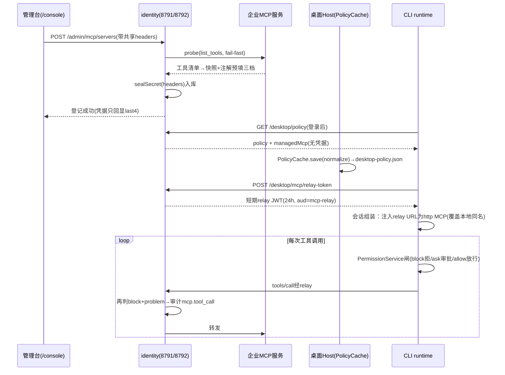

# MCP 治理平面（P0：服务端注册表 + relay 托管 + 端侧强制）spec v1

> 背景：对照 KnowWork 管理员端分析（见 2026-11 会话结论），本产品 MCP 只有端侧运行时（配置管理 / OAuth / 信任审查），没有服务端治理平面。本 spec 落地管理台 `menu.tsx` 已规划的「MCP 服务」（第 5 批）第一批：**注册表、工具快照、每工具三档策略、策略下发、relay 凭据托管、端侧两级强制**。

## 1. Product rules

- 企业托管的 MCP 服务由平台管理员在管理台登记；类型 `http` / `sse`，认证为「无需认证」或「共享凭据（请求头）」（PAT/Basic/Bearer 均以 header 形态表达）。
- **凭据只存服务端**：共享 headers 用 AES-256-GCM 封存（`common/secrets-crypto.ts`），任何下发 payload、端侧缓存、审计、日志都不含凭据明文；管理台只回显 header 名 + 值末四位。
- 端侧调用一律经**服务端 relay**（identity 用户面 8791），端侧配置里只有 relay 地址 + 短期 relay JWT，不含上游地址与凭据。
- 托管服务对企业用户是「企业为准」：会话组装时与本地同名 MCP 配置冲突，托管版覆盖本地（本地被覆盖记 warn）；用户不可关闭、不可编辑托管服务。
- 每个工具三档策略：`允许（allow）/ 需确认（ask）/ 禁用（block）`。**首次登记**按 MCP 注解预填（`readOnlyHint === true` → allow，其余 → ask）；**之后的同步新增工具一律 ask 并标「新」**（防上游升级提权），管理员对该工具显式设过策略即固化（清「新」标记）。
- 工具名规范（授权键规范）：模型可见名 `mcp__<服务名>__<工具名>`；服务名禁下划线 `^[a-z][a-z0-9-]{0,23}$`，保证 `mcp__<服务名>__` 前缀无歧义、可按 `tool:mcp__<服务名>__*` 通配授权（为第 4 批「统一工具目录」预留授权实体键）。
- 参数 schema 不合格的工具标 `problem`：不注册给模型（等同 block），relay 同样拒绝执行——坏工具不许拖垮会话。
- 未登录 / 策略拉取失败 / 老服务端（无 `managedMcp` 字段）→ **无托管服务**，绝不因解析失败放大。

## 2. Ownership and boundaries

| 状态 | 唯一所有者 | 其余角色 |
| --- | --- | --- |
| 服务注册表 / 快照 / 三档策略 | `server/packages/server/src/mcp/`（schema 建表、repo SQL、routes HTTP） | 管理台只读写接口；端侧只读下发缓存 |
| relay 短期令牌签发/校验 | identity（8791 用户面） | 无状态 JWT，不落表 |
| 端侧策略缓存 | Host `ReactorPolicyCache`（写 `desktop-policy.json`） | CLI `createDesktopPolicySource` 只读（mtime 重读） |
| 托管服务进会话 | `packages/services` 会话组装（注入 relay 条目） | CLI bootstrap/core 不自己取托管配置 |
| 审批决策 | 端侧 `PermissionService` 闸（ask/allow 本会话语义） | relay 只再判 block/problem（服务端兜底，不替代审批） |

**依赖方向**：`mcp/` 域内 routes→repo→schema；跨模块（audit 组装、desktop/policy 下发）只经 repo 公开入口；gateway（8790）本 P0 不接入。契约三边手工同步：`server/packages/shared/src/audit.ts` 的 `DesktopPolicy` ↔ 主仓 `packages/shared/src/desktopPolicy.ts` 的 `ReactorDesktopPolicy`（两个 workspace 不共享运行时，改口径必须同步，参照 `productDocsUrl` 先例）。

## 3. 数据模型

`mcp_server`（identity 启动批 `ensureMcpSchema` 幂等建表，无迁移框架纪律）：

| 列 | 说明 |
| --- | --- |
| id | 服务端生成稳定 id（下发与 relay 引用它） |
| name | 唯一，`^[a-z][a-z0-9-]{0,23}$`，建后不可改（即工具名前缀段） |
| display_name | 展示名 |
| type | `http` / `sse` |
| url | 上游地址（http/https、无查询参数；凭据只许放请求头） |
| auth | `none` / `shared` |
| headers_ciphertext | JSONB，`{名: sealSecret(值)}`（auth=shared 时） |
| header_names | JSONB，`[{name, last4}]`（回显用） |
| enabled | 停用后 relay 拒绝、下发不携带 |
| tools_snapshot | JSONB：`[{name, description, annotations, inputSchema, problem?, isNew}]`，上限 200 |
| tool_policy | JSONB `{工具名: allow/ask/block}`；不在表内的工具=ask |
| synced_at / sync_error | 手动同步成功时间 / 最近失败原因 |
| created_by / updated_by / updated_at | 审计口径 |

下发 payload（`GET /desktop/policy` 的 `managedMcp.servers[]`，**无凭据无上游 URL**）：

```jsonc
{ "id": "...", "name": "crm", "displayName": "CRM", "type": "http",
  "enabled": true, "toolPolicy": {"list_contacts": "allow"}, "defaultToolPolicy": "ask", "updatedAt": "..." }
```

## 4. 接口

管理面（8792 管理台，`requireAdmin` + adminAudit 兜底）：

| 方法/路径 | 语义 |
| --- | --- |
| `GET /admin/mcp/servers` | 列表（凭据只回显 header 名 + last4） |
| `POST /admin/mcp/servers` | 登记；**先 probe 拉快照，失败 422 不保存（fail-fast 不留半成品）** |
| `PATCH /admin/mcp/servers/:id` | 修改；url/auth/headers 变化才重新 probe |
| `DELETE /admin/mcp/servers/:id` | 删除（端侧下次策略刷新即失去） |
| `POST /admin/mcp/servers/:id/sync` | 手动同步快照；**失败 200 + `ok:false` + 保旧快照只记 sync_error** |
| `PUT /admin/mcp/servers/:id/tool-policy` | 整体替换三档策略表 |
| `POST /admin/mcp/servers/:id/probe` | 连通测试（恒 200 + `ok` + 脱敏 error + 工具数/延迟） |

用户面（8791 authed 组）：

| 方法/路径 | 语义 |
| --- | --- |
| `GET /desktop/policy` | 追加 `managedMcp` 字段（见 §3） |
| `POST /desktop/mcp/relay-token` | 签短期 relay JWT（aud `mcp-relay`，sub=用户，TTL 24h） |
| `POST /desktop/mcp-relay/:id` | JSON-RPC 转发（透传 `mcp-session-id`），注入共享 headers；逐调用再判：停用 / 工具 block / 工具 problem → JSON-RPC error `denied`；写 `mcp.tool_call` 审计 |
| `GET /desktop/mcp-relay/:id` | SSE 流转发（同鉴权与再判） |
| `DELETE /desktop/mcp-relay/:id` | 会话关闭转发 |

**挂载例外**：relay 数据面三端点挂**公开段**（authed 组之前，updates/feedback 公开面同一机制）——authed 组会把 relay 短期令牌当 access 验（audience 不同）→ 一律 401（实测踩过）。relay 自带 `aud=mcp-relay` 鉴权，挂公开段让长期 access 令牌不进转发链，更安全。

## 5. 状态所有者与事件顺序



幂等/时序边界：策略缓存「拉取失败保留上一份、未登录清缓存」语义不变（`reactorPolicySync.ts`）；relay 无会话业务状态（会话状态在 MCP 上游，`mcp-session-id` 双向透传）；被覆盖的本地同名 server 只在本会话生效，不改动用户本地配置文件。

## 6. 错误语义

- probe：超时 / 401/403→凭据问题 / 404→地址或端点不对 / 响应非法→不是 MCP 端点；文案给管理员，不含上游响应原文。
- relay：401（无/坏 relay token）；JSON-RPC error `denied`（停用 / block / problem）；上游错误原样转发（状态码 + JSON-RPC error 体），不吞错不回退。
- 端侧：策略解析失败按无托管（不放大）；relay 不可达按该 server 连接失败呈现（沿用现有 MCP 失败指引 UI），不阻塞其余工具。

## 7. 验收场景

1. 登记无需认证 MCP → 登录用户的会话可见并调用其工具。
2. 某工具设「禁用」→ 策略刷新后该工具从会话消失（注册期不注册），且执行期闸独立拒绝。
3. 「需确认」弹审批、「允许」不弹；上游新增未登记工具 → 默认「需确认」。
4. 共享凭据服务经 relay 调通；端侧任何配置/缓存文件中不含凭据明文。
5. 未登录 / 策略拉取失败 → 无托管服务（不放大）。
6. 删除服务 → 端侧下次同步消失，审计留痕。
7. relay 独立拒绝 block/problem 工具调用（双保险）。

## 8. 不在本期范围（P1+）

按人 PAT/OAuth 连接与「设置 → 连接」页、stdio 托管、多空间/部门受众（授权实体落地）、relay 端 ask 审批状态服务端化、统一工具目录页（第 4 批）、动作回执幂等四态、审计保留期策略。
