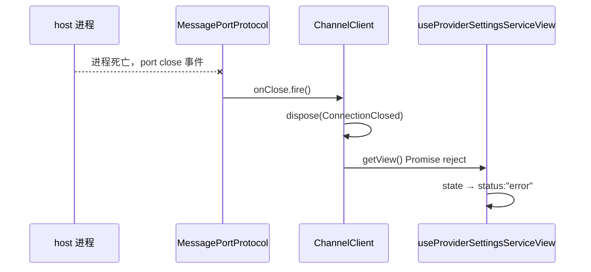
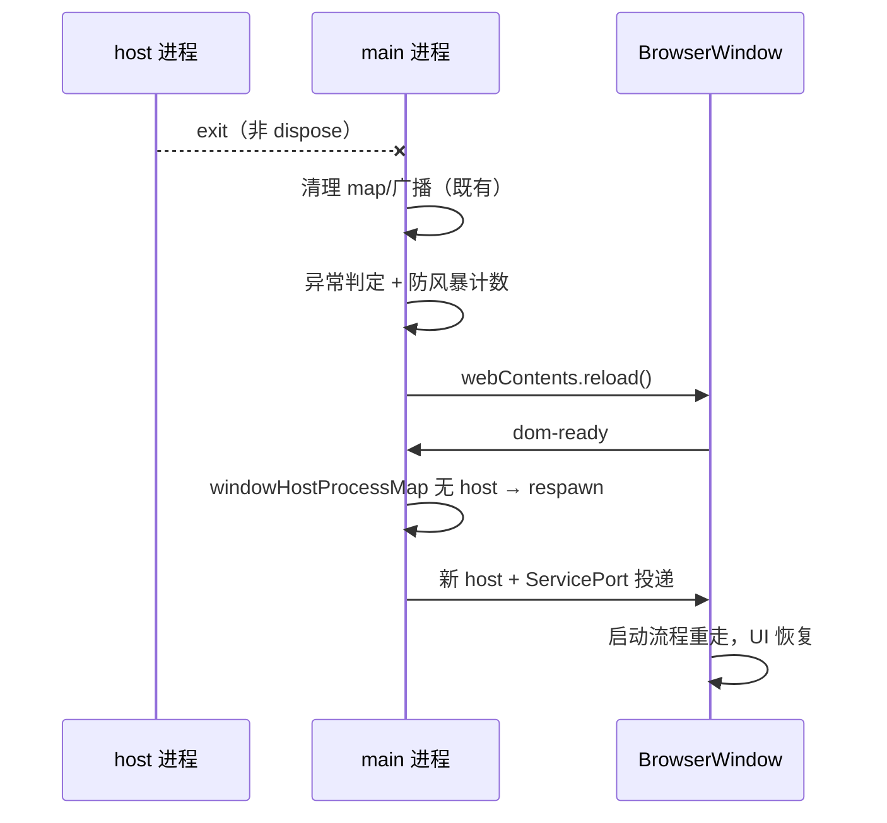

# host 生命周期与 RPC 断连修复 · 方案 v1

- 状态：已实现（2026-10-12）
- 关联现象：「模型设置」页永久转圈；「专家·技能」市场连不到服务端数据
- 根因结论：以上两者是**同一个病的两个症状**——host 进程死亡后主进程不恢复、renderer 侧 RPC 永久挂起

## 1. 背景与进程模型

桌面端三进程协作，renderer 的所有业务数据都通过 RPC 向 host 索取：

host 由 main fork（`utilityProcess`），职责是承载全部业务服务（file/git/terminal/zcodeTask/zcodeAgent/zcodeSession/plugin/skill/mcp 等）与 agent 进程树。renderer 经 main 投递的 `MessagePort` 建立 `ChannelClient` 连接。

## 2. 已查证的缺陷（三个，均有源码/日志证据）

### D1 host 退出后主进程不重建

`packages/desktop/src/main/desktopHostProcess.ts` 的 `child.on("exit")` 处理器只做清理（删 map、注销广播），**没有任何重建逻辑**。host 死后窗口仍开着，全部业务 RPC 瘫痪，直到用户手动重启应用。

日志证据（2026-10-12）：`16:47:40 host process (local-1) exited with code 0`，此后 1 小时无任何 host 重建记录；同一时段安装版实例的 4 次 host 退出均伴随 `app-quit`/`window closed`，属正常重启，dev 实例这次是**孤立死亡**。

### D2 RPC 永久挂起（fail-hidden）

挂起的 RPC 只有两条 settle 路径：正常响应，或 `ChannelClient.dispose(reason)`（`channelClient.ts:249-272`，dispose 会 reject 全部 pending）。而：

- `IMessagePassingProtocol`（`protocol.ts:24-28`）**没有 onClose 通道**；
- `MessagePortProtocol`（`protocol.ts:361-397`）只监听 port 的 `message` 事件，port 关闭（对端进程死亡）无任何传播；
- `ChannelClient` 只订阅 `protocol.onMessage`，对传输层断连无感知；
- `connectViaMessagePort`（`packages/client/src/messageport.ts:57-59`）**丢弃了 `createMessagePortServiceConnection` 已设计好的 dispose 句柄**。

结果：host 死 → port 关闭 → 无人通知 ChannelClient → `providerSettingsService.getView()` 的 Promise 永不 settle → `useProviderSettingsServiceView` 停在 `status: "loading"` → 界面永久转圈。日志中**没有** `[ProviderSettings] 加载目标 Environment 失败`，证明从未走 reject 分支。

`serverSkillSyncService`（市场同步器）同样跑在 host 侧，host 死后一起瘫痪——这与 D2 是同一根因。

### D3 host stderr 被 relay 静默丢弃（证据缺口）

`packages/desktop/src/main/hostLogRelay.ts` 的 `onStderr`（76-82 行）在 `hasStructuredLog = true` 后**直接丢弃**。host 正常运行时持续上报结构化日志，因此运行期的 stderr 全部丢失，`flushRawLogs` 仅在 host 从未发过结构化日志时才有兜底内容。

这就是 host 静默死亡时"没有任何前置异常日志"的原因：不是 host 没输出，是**输出被丢了**。

## 3. 修复方案

### F1 RPC 断连 fail-closed（packages/rpc）

| 项 | 内容 |
|---|---|
| 接口 | `IMessagePassingProtocol` 增加可选 `onClose?: Event<void>` |
| `MessagePortProtocol` | 监听 port 的 `close` 事件并 fire `onClose`；`disconnect()` 时同样 fire（幂等） |
| `ChannelClient` | 构造时订阅 `protocol.onClose`，触发即 `dispose(new Error(...))`，复用既有 pending rejection 机制 |

事件顺序：

语义：断连后所有挂起 RPC 以 `ConnectionClosed` 错误 reject，UI 进入既有 error 态（`loadError` 已接线，`ModelProviderSection` 渲染错误+重试）。**正常路径零影响**：`onClose` 为可选接口，旧传输实现不实现即无行为变化；remote session 换代本就调用 dispose，语义一致。

### F2 host 异常退出后经 renderer reload 恢复（packages/desktop main）

| 项 | 内容 |
|---|---|
| 异常判定 | exit 时 `!disposingHostProcesses.has(child)` 即异常（应用退出/窗口关闭的主动 dispose 会写入该集合） |
| 恢复动作 | 窗口未销毁且为主应用窗口时 `win.webContents.reload()` |
| 重建路径 | **复用现有机制**：reload 后 `dom-ready`（`desktopWindowLifecycle.ts:125+`）发现 `windowHostProcessMap` 中 host 已被 exit handler 删除 → 走 respawn 分支 spawn 新 host 并重新投递 port |
| 防风暴 | 按窗口记录自动 reload 时间戳，60s 内 ≥2 次则停止自动 reload，仅打 error 日志等用户手动操作 |

明确**不做**：renderer 侧热替换 services 树（`services` 是 React 根 props，替换等于全树重挂载，收益与 reload 等价而复杂度高一个量级）。host 死亡时运行中会话本已丢失，reload 让整套启动流程重走（新 host、新 port、状态从持久层恢复）是最短恢复路径。

事件顺序：

### F3 host stderr 立即回放（packages/desktop main）

`hostLogRelay.onStderr` 去掉 `hasStructuredLog` 门控：stderr 到达即按 warn/error 分级写入 main 日志，不再入缓存、不再等待 exit 兜底。stdout 兜底逻辑保持原样（stdout 是正常输出通道，量大，维持"结构化优先"策略）。

## 4. 验收场景

| # | 场景 | 期望 |
|---|---|---|
| A1 | host 异常退出（模拟 kill） | renderer 自动 reload 恢复；日志有异常退出记录与 reload 记录 |
| A2 | host 退出后 60s 内再次异常退出 | 第二次不再自动 reload，日志明确记录风暴抑制 |
| A3 | 应用正常退出 / 窗口关闭 | 不触发 reload（`disposingHostProcesses` 命中），行为与现状一致 |
| A4 | MessagePort 对端关闭 | 挂起 RPC 以 `ConnectionClosed` reject；设置页显示错误+重试而非转圈 |
| A5 | 正常 RPC 调用 | 全链路无回归（既有测试 + typecheck + lint + architecture:check） |
| A6 | host 死亡前输出 stderr | main 日志立即可见该 stderr（不再被丢弃） |

## 5. 影响面

- `packages/rpc`：`protocol.ts`（接口+MessagePortProtocol）、`channelClient.ts`（订阅 onClose）
- `packages/desktop`：`desktopHostProcess.ts`（exit 恢复+防风暴）、`hostLogRelay.ts`（stderr 立即回放）
- `packages/client`：不改（`connectViaMessagePort` 保留现有签名；dispose 句柄的启用属 remote session 既有路径，F1 后本地连接断连由 ChannelClient 自治处理）

## 6. 明确不修（记录在案）

- **host 静默 exit(0) 的触发条件仍未定位**。已排除 SIGTERM/SIGINT/parent disconnect/uncaughtException（这些路径在 `host/index.ts:2237-2284` 都会先打 `disposing host resources` 且退出码非 0）。F3 落地后，下次复现即可拿到死前 stderr 证据再定位。在证据不足前不做"猜测性修复"（如盲目加保活定时器）。
- `host 死后会话/agent 的恢复`超出本次范围：reload 后从持久层恢复，运行中未完成 turn 丢失属既有语义。
