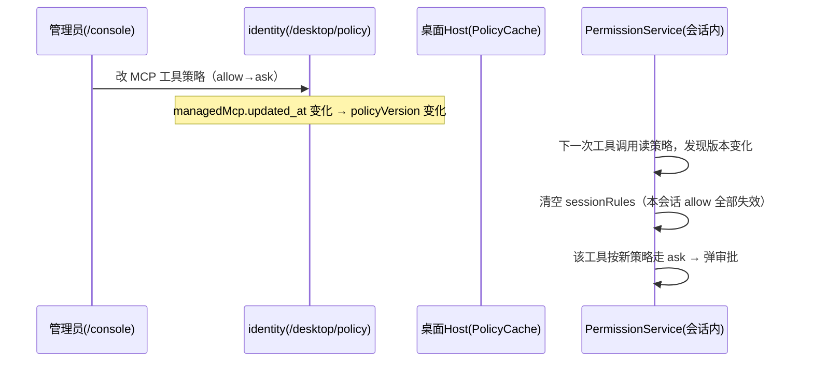

# 审计脱敏与审批版本联动（治理吸收第二批）方案 v1

> 来源：KnowWork 管理员端对比吸收清单的第一轮 P0-3（审计工程细节）与 P1-2（审批授权绑策略版本）。两项都是小改动、纯增益，不改动既有审计口径（NFR-P-01 不落正文红线不变，本方案把红线从「约定」升级成「机制」）。

## 1. Product rules

### A. 审计工程细节（服务端 `server/packages/server/src/audit/`）

- **404 无路由不记**：管理操作兜底中间件对最终响应 404 的请求不落审计（防扫描器刷表）；其余状态语义不变（401/403/429 → `denied`，5xx/其它非 2xx → `error`，2xx → `ok`）。
- **落盘脱敏管道（机制化 NFR-P-01）**：`recordAdminAction` 的 `details` 在入库前统一过 `sanitizeAuditDetails`——
  - 键名命中 `password|passwd|token|secret|credential|api[_-]?key|authorization` 的项：**键保留、值替换为 `[已脱敏]`**（保结构便于对照，密文/明文都不落）；
  - 字符串值命中凭据形态（`Bearer …`、`sk-…`、JWT 头 `eyJ`、PEM 私钥块）→ 同样替换 `[已脱敏]`，与键名无关；
  - 字符串值限长 256 字符（超长截断加 `…`）；顶层键 ≤16 项；details JSON 总量 > 64KB 整体截断为 `{ truncated: true }`。
  - `summary` 与端侧事件入库路径（`insertAuditBatch`）同样过一遍**值形态**脱敏（summary 是调用方手写的短标签，误写密钥也不落）。
- **键集分页（只增不改表）**：`GET /desktop/audit` 新增可选游标 `beforeTs`/`beforeId`（两者必须成对出现；提供时忽略 `offset`，按排序键 `(ts, id)` 行比较取「更早的一页」）；响应新增 `nextCursor: { beforeTs, beforeId } | null`。既有 `offset` 参数与语义保留（CSV 导出与旧客户端不动）；管理台「下一页」改走游标，避免深翻页时 OFFSET 慢查询与插入导致的漂移。

### B. 审批授权绑策略版本（主仓 CLI + 服务端契约）

- **`GET /desktop/policy` 响应新增 `policyVersion`**：内容寻址派生值（sha256 of `desktop_policy.updated_at + managedMcp 各服务的 (id, updatedAt, toolPolicy JSON)`），不落库、每次组装现算；策略或托管面任一变化，版本必变；无变化必不变。
- **端侧会话授权失效**：`PermissionService` 记住最近一次见到的 `policyVersion`；版本变化（含首次从无到有）即**清空会话级 allow 规则**（`sessionRules`），被管理员改动的「本会话不再询问」授权自动失效、重新询问。查询出错按无版本处理（不误清）。
- **不失效的东西**：本地持久 allowAlways 规则不清——管理员收紧为 ask/block 时端侧闸（托管三档）已经压过持久规则立即生效；管理员显式允许的语义由策略本身表达，不需要反向撤用户的本地规则。
- **无版本 = 不联动**：老服务端（无 `policyVersion` 字段）与未登录（无策略文件）行为与现状完全一致。

## 2. Ownership and boundaries

| 状态 | 唯一所有者 |
| --- | --- |
| 脱敏管道（纯函数） | `server/packages/server/src/audit/sanitize.ts`；调用方只有 `repo.recordAdminAction` 与 `insertAuditBatch`（summary） |
| 会话授权生命周期 | CLI `core/permission/service.ts`（`sessionRules` 随 policyVersion 失效） |
| `policyVersion` 派生 | `server/packages/server/src/audit/routes.ts` 组装处（与 `allowedInterfaceModes`/`managedMcp` 同一「现算」模式） |
| 契约字段 | `server/packages/shared/src/audit.ts` ↔ 主仓 `packages/shared/src/desktopPolicy.ts` 手工同步（既有纪律） |

## 3. 事件顺序（版本联动）

## 4. 验收场景

1. 管理台扫描器 `POST /admin/不存在路径` → 404 → **不落** `admin_action`；`POST /admin/mcp/servers` 403（非管理员）→ 落 `denied`。
2. 手写埋点误把含 `apiKey: "sk-xxxx"` 的快照写进 `details` → 库里该值为 `[已脱敏]`，键名保留；summary 里粘了 `Bearer eyJ…` → 落库前被替换。
3. 管理台审计页翻 3 页后新事件插入，游标翻页仍数得上同一批、无重复无遗漏；`offset` 参数行为不变。
4. 会话内对托管 MCP 工具点了「本会话不再询问」→ 管理员把该工具改为 ask（policyVersion 变）→ 下一次调用**重新弹审批**。
5. 老服务端（无 policyVersion）/ 未登录：行为与现状一致，不误清、不误问。

## 5. 不在本期

审计保留期批删（90 天/5000 行批）、写队列满丢弃语义（现实现已不阻塞）、`FanoutSink` 外发扩展点。
