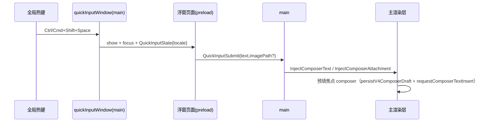

# 未完成：快捷输入浮窗（spec v1）

## 背景

参考 NewMax 的快捷输入浮窗（B4）：一个常驻的轻量输入窗口，全局热键唤起，随手问一句，
提交后转交主窗口 composer。上一轮悬浮球 spec 已明确「不做浮窗，属独立工程」，本轮落地。

## 产品规则

- **全局热键唤起**：`CommandOrControl+Shift+Space`（避开已占用的 `CommandOrControl+Shift+B`）。
- **内容转交主窗口 composer**：浮窗本身不发模型请求；提交的文本走
  `InjectComposerText`、图片走 `InjectComposerAttachment`，复用主窗口 composer 的完整提交链路。
- **可聚焦**：与 CUA 权限浮窗不同，输入框必须能键入，故去掉 `type:"panel"` 与
  `focusable:false`，改用 `show()` + `focus()`。
- **失焦即收起**：符合「随手问一句」的浮窗语义。
- **不做附件/技能/模型选择等全套 composer 复用**：浮窗只承担「快速输入文本」这一件事，
  其余能力仍在主窗口 composer 完成（见「边界与遗留」）。

## 状态所有者

| 环节 | 所有者 |
| --- | --- |
| 窗口生命周期 + 全局热键 | `packages/desktop/src/main/quickInputWindow.ts` |
| 浮窗 UI | `packages/desktop/src/renderer/quick-input.html` + `quickInput.ts` |
| preload 桥 | `packages/desktop/src/preload/quickInput.ts` |
| 提交通道 | `PlatformChannels.QuickInputSubmit`（浮窗 → main） |
| 语言同步 | `PlatformChannels.QuickInputState`（main → 浮窗） |
| 转交 | `InjectComposerText` / `InjectComposerAttachment`（main → 主 renderer） |

## 事件顺序

## 验收场景

1. 按热键 → 浮窗出现并聚焦；再按 → 收起。
2. 输入文本回车 → 浮窗收起、主窗口前置、焦点 composer 出现该文本。
3. 失焦（点别处）→ 浮窗自动收起。
4. 空内容提交 → 仅收起，不注入。

## 验证

- 受影响包链增量 `tsc -b`（main/preload）+ 改动文件 `oxlint` + 全量 `pnpm typecheck` 通过。
- 热键、窗口交互与视觉需打包运行验证。

## 边界与遗留

- **语音/附件按钮/`/`技能/`@`提及/思考等级/权限模式/MCP 未纳入浮窗**：那些需要把主窗口 composer
  的完整状态机跨窗口复用，属重工程；本版浮窗只做文本快速输入（图片通道已预留）。
- **「留在浮层」选项未做**：当前提交后恒定收起并前置主窗口。
- 浮窗内不做图片选择 UI：`imagePath` 通道已就绪，待后续接入截图/选择入口。
