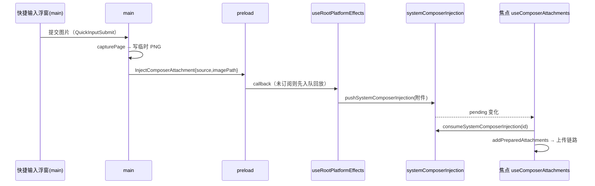

# 未完成：系统侧内容交接 composer（spec v1）

## 背景

参考 Namiwork（悬浮球快捷动作）与 NewMax（外部图片交接），补齐「系统侧产生的内容
（截图、外部图片、快捷输入）落到当前对话」的通道。Reactor 原先只有 composer 内的
拖放/粘贴/文件选择，没有「系统级来源」进入 composer 的路径。

> 2026-10-19 更新：悬浮球来源已整体移除（两轮实测点击无反应，见
> `已完成/已完成-桌面悬浮球-已移除-spec-v1.md`）；当前在用的来源为
> **快捷输入浮窗**（`Ctrl/Cmd+Shift+Space`）与**外部图片交接**。

## 产品规则

- **外部来源 → 焦点 composer**：系统侧内容只落到**唯一拥有焦点**的 composer；
  竖切多 pane 时不抢注入到后台草稿（与 `whiteboard:add-to-chat` 的「焦点 pane 处理」一致）。
- **运行态、不持久化**：附件含 File/objectUrl 不可序列化，且 `composerDraftStore`
  已裁决「附件不入草稿」——注入只在内存态一次性移交。
- **复用同一条上传链路**：注入内容与手动添加附件的上传/暂存/发送完全同路径，不新开旁路。

## 状态所有者

| 环节 | 所有者 |
| --- | --- |
| 来源产生（截图/图片路径） | main 进程（快捷输入浮窗提交 / 外部图片交接） |
| 跨进程传输 | `PlatformChannels.InjectComposerAttachment`（Main → Renderer） |
| preload 接住与回放 | `packages/desktop/src/preload/index.ts`（callback 集合 + 待回放队列） |
| renderer 落点 | `useRootPlatformEffects` → `pushSystemComposerInjection(...)` |
| 待注入队列 | `packages/ui/src/store/systemComposerInjection.ts`（全局 store） |
| 认领 | `useComposerAttachments`，条件 = `listenAddToChatEvents && !disabled`（= `SessionPane.focused`） |
| 上传/发送 | 既有 `addPreparedAttachments` 链路（唯一） |

## 事件顺序

## 接口

- `PlatformChannels.InjectComposerAttachment: "zcode:inject-composer-attachment"`
- `ComposerAttachmentInjectionPayload { source; imagePath }`（`@zcode/shared/platform.ts`）
- `IPlatformService.onInjectComposerAttachment?(handler)`（desktop preload 实现）
- `pushSystemComposerInjection / consumeSystemComposerInjection`（全局 store）
- `useComposerAttachments().injectAttachments(attachments)`（程序化注入，供浮窗等后续复用）

## 验收场景

1. 焦 composer 存在时经快捷输入浮窗提交图片 → 焦点 composer 出现该图片附件。
2. 竖切两个 pane → 只有焦点 pane 的 composer 收到，后台 pane 不受影响。
3. UI 尚未订阅（冷启动竞态）→ preload 先入队，订阅建立后回放。
4. 注入的附件走与手动添加相同的上传/发送链路，`prepareForSend` 门禁一致。

## 验证

- 受影响包链增量 `tsc -b` + 改动文件 `oxlint`；全量 `pnpm typecheck` 通过。
- 端到端视觉需打包运行验证（快捷输入浮窗 + 外部图片交接）。

## 边界与遗留

- **快捷输入浮窗（d）**：已落地（`quickInputWindow.ts` + `Ctrl/Cmd+Shift+Space` +
  `InjectComposerText` 文本转交 + 图片经本通道注入），详见
  `未完成-快捷输入浮窗-spec-v1.md`。
- **全局文件拖入的「任意位置落附件」**：仍受 composer scope 限制，未做 shell→composer 全量通道。
- c 的「系统截图工具 → 应用未聚焦」路径需要先唤起应用再由焦点 composer 认领，未做托盘/热键级触发。
